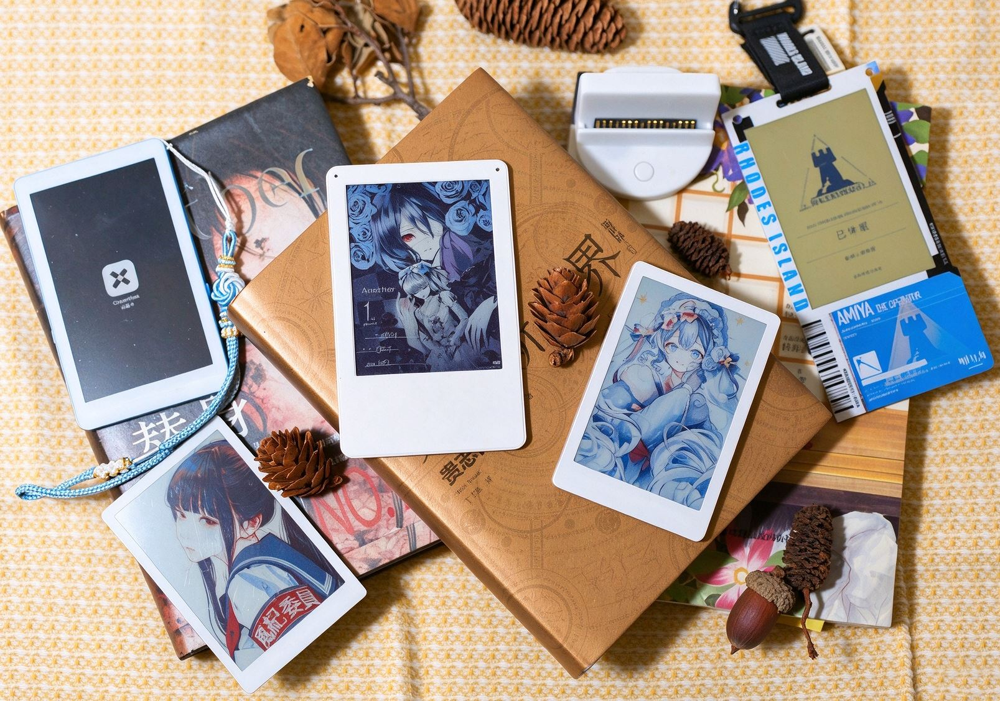
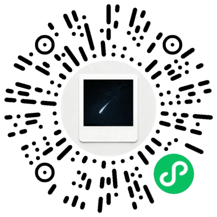

# FrameFilm（帧影）

[中文](README.md) ｜ [English](README.en.md)

<div align="center">



*Color e-paper display × low power × multi-platform transfer*

[](LICENSE)
[](https://www.espressif.com/) 

</div>

---

## Project Overview

FrameFilm（帧影）is a family of color e-paper products and the tools that go with them.

The hardware includes fridge magnets (Standard / Pro), the Max desktop photo album, the Ark passport edition and the Dock e-paper base. Every product uses a color e-paper panel that keeps its image without power, and accepts images from a phone, the web or a cloud service over Bluetooth, WiFi or USB.

"帧影" means "one frame, one shadow — freezing time". The English name FrameFilm combines "frame" and "film".

Companion software includes the on-device apps (photos / templates / clock / animation / passport), the ForFilm web tool, a WeChat mini program, a Flutter mobile app, and the self-hosted Film-hub cloud service.

## Product Line

| Product | Firmware directory | Display | Highlights |
|------|---------|------|------|
| Fridge magnet Standard | `firmware/frame_film`（`FRAMEFILM_STD`） | 3.6" 600×400 | Rotary encoder with button, WS2812 LED |
| Fridge magnet Pro | `firmware/frame_film`（`FRAMEFILM_PRO`） | 3.68" 792×528 | Three buttons, WiFi, wireless charging |
| Photo album Max | `firmware/frame_film`（`FRAMEFILM_MAX`） | 7.09" 1200×1600 dual panel | Large photo album, three buttons, no LED |
| Passport edition Ark | `firmware/frame_film_ark` | 3.70" 720×480 | Single model; app framework and LVGL UI layer |
| E-paper Dock | `firmware/frame_film_dock` | 3.64" 760×568 | USB composite device: audio + HID keyboard + CDC serial |
| Xiaoying FilmReader | Derivative build (FrameFilm mainboard + CrossMux firmware) | 3.97" 800×480 four-gray | Monochrome e-paper reader; four buttons, SD card, wireless charging |

> Standard / Pro / Max share one firmware, separated at compile time by model macros and `sdkconfig`; the panel can be chosen per model in `hal_epd.h` (see "Selectable Screens" below).

## Open-Source Hardware Projects

Schematics, PCBs, BOMs, enclosures and production files are published on OSHWHub:

| Project | Description |
|------|------|
| [FrameFilm Standard](https://oshwhub.com/kiritro/project_ttfkoxxv) | Fridge magnet base model, E6 full-color V2 |
| [FrameFilm Spark Edition](https://oshwhub.com/kiritro/project_uaqmgawa) | Optimized circuit: NU1680 wireless charging, 32-pin 3.7" and 24-pin 1.54" E6 support, three hardware variants |
| [FrameFilm Dock](https://oshwhub.com/kiritro/project_pgrmtgch) | E-paper base (audio / HID / CDC) |
| [Xiaoying FilmReader](https://oshwhub.com/kiritro/project_bppplpbn) | 3.97" monochrome e-paper reader derivative build |

**Derivative modules:**

| Module | Description |
|------|------|
| [E-Ink color E6 driver module](https://oshwhub.com/kiritro/project_wlvjnmls) | For 3.6 / 4 / 7.3 inch Waveshare and Good Display E6 color panels |
| [NU1680 wireless charging receiver](https://oshwhub.com/kiritro/project_tscyabux) | 5V / 1A, Qi compatible, 15×10×0.8 mm, optional reverse-current protection, MIT licensed |

> Mainboard design and firmware are maintained in this repository; OSHWHub projects are for fabrication and reproduction — BOM, assembly and fabrication parameters follow each project's attachments.

## Core Features

- **Color e-paper display**: image retention without power, no backlight, low power.
- **Image conversion**: multiple dithering algorithms convert photos into six-color frames, with single-image, multi-frame and animation support.
- **Multiple connections**: phones and the web use Bluetooth; Pro and Ark support WiFi; the Dock supports USB.
- **Mounting**: magnets on the back for fridge magnets, desktop stand for the Max album.
- **On-device UI and content apps** (Ark only): five apps — photos, templates, clock, animation and passport — plus main menu, system settings, boot screen and sleep card; supports BLE remote keys (`0x4E`) and time sync (`0x4D`).
- **Dock as a PC peripheral** (Dock only): its buttons act as a PC keyboard, while USB enumerates an audio device and a virtual serial port for direct image upload.
- **Cloud delivery**: with Film-hub, images can be updated remotely or rotated on a schedule.

## Firmware Components

All three firmware lines follow a one-way **`film_service` → `film_hal` → `film_sys`** layering; reverse dependencies are not allowed.

| Component | Responsibility | `frame_film` | `frame_film_ark` | `frame_film_dock` |
|------|------|:---:|:---:|:---:|
| `film_sys` | System init, logging, config, event bus | ✅ | ✅ | ✅ |
| `film_service` | BLE, file management, photo playback, parameter storage | ✅ | ✅ | ✅ |
| `film_hal` | E-paper, battery, LED, input, SD, USB | ✅ | ✅ | ✅ |
| `film_app` | App framework: scheduling, menu, settings, content apps | — | ✅ | — |
| `film_ui` | LVGL UI layer: page lifecycle, display pipeline, assets | — | ✅ | — |

> The Dock shares one command parser (`film_service/src/service_cmd.c`) between BLE and USB — new commands only need to be added there.

## Selectable Screens

Panels are not tied to a model: inside the model branch of `hal_epd.h`, set the target `EPD_SELECT_E6_*` to `1` and the others to `0`.

| Panel | Resolution | Panel ID | Macro | Driver |
|------|--------|---------|-----|------|
| 3.68" | 792×528 | 0x01 | `EPD_SELECT_E6_3_68_792_528` | `hal_epd_368.c` |
| 3.70" | 720×480 | 0x02 | `EPD_SELECT_E6_3_70_720_480` | `hal_epd_370.c` |
| 3.6" | 600×400 | 0x03 | `EPD_SELECT_E6_3_60_600_400` | `hal_epd_360.c` |
| 1.54" | 240×240 | 0x04 | `EPD_SELECT_E6_1_54_240_240` | — |
| 7.09" dual panel | 1200×1600 | 0x05 | `EPD_SELECT_E6_7_09_1600_1200` | `hal_epd_709.c` |
| 3.64" | 760×568 | 0x06 | `EPD_SELECT_E6_3_64_760_568` | `hal_epd_364.c`（Dock default） |
| 3.98" | 768×552 | 0x07 | `EPD_SELECT_E6_3_98_768_552` | `hal_epd_398.c` |
| 3.98" four-color | 768×552 | 0x08 | `EPD_SELECT_E4_3_98_768_552` | `hal_epd_398e4.c` |
| 3.97" monochrome | 800×480 | — | — | FilmReader uses SSD1677 (four-gray); no driver in this repo |

> `0x07` (SE0398 3.98") is a newly added option, disabled by default; set it to `1` to enable. It uses 4-wire SPI + DC and only fits the STD / Pro wiring (the Max has no DC pin).
> `0x08` (JD79665AA 3.98" four-color) only has black/white/yellow/red; ForFilm detects this panel and outputs four-color images automatically. A full refresh takes about 15 s, and it also only fits STD / Pro wiring.
> The 3.97" monochrome panel (SSD1677) is used by the Xiaoying FilmReader derivative build, which runs CrossMux firmware; none of the three firmware lines here include its driver. See "Xiaoying FilmReader" below.
> The panel ID is returned to clients in the `0x42` response so they can correct the resolution; the client still identifies the model by the BLE advertising name.

## Hardware Specifications

### FrameFilm (Standard)

| Parameter | Spec |
|------|------|
| MCU | ESP32-S3 WROOM N16R8 |
| Display | Color e-paper 3.6" 600×400 (WFT driver) |
| Storage | TF card up to 32GB or built-in SD NAND |
| Connectivity | Bluetooth BLE 4.2 |
| Input | Rotary encoder with button |
| Battery | Li-ion 304040, 1.5 mm connector |
| Dimensions | Approx. 92 × 60 × 7 mm |
| Mounting | Rear magnets 2x12mm-1mm, 1x15mm-2mm |

### FrameFilm Pro

| Parameter | Spec |
|------|------|
| MCU | ESP32-S3 mini N4R2 |
| Display | Color e-paper 3.68" 792×528 (SE0368-C driver) |
| Storage | Built-in SD NAND |
| Connectivity | Bluetooth BLE 4.2 / WiFi |
| Input | Three buttons |
| Battery | Li-ion 244147 |
| Charging | Wireless charging (MagSafe compatible) |
| Dimensions | Approx. 90 × 59 × 5 mm |
| Mounting | Rear MagSafe magnet ring |

### FrameFilm Max (Photo Album)

| Parameter | Spec |
|------|------|
| MCU | ESP32-S3 N16R8 (16MB Flash / Octal PSRAM) |
| Display | Color e-paper 7.09" 1200×1600 dual panel |
| Storage | TF card |
| Connectivity | Bluetooth BLE 4.2 |
| Input | Three buttons |
| LED | No RGB LED |
| Battery | No battery level detection |

### FrameFilm Ark (Passport Edition)

| Parameter | Spec |
|------|------|
| MCU | ESP32-S3 N4R2 (4MB Flash / Quad PSRAM) |
| Display | Color e-paper 3.70" 720×480 (panel ID `0x02`) |
| Storage | TF card with detect pin |
| Connectivity | Bluetooth BLE 4.2 |
| Input | Three buttons (up / down / confirm, active low) |
| LED | WS2812 (white = disconnected, green = connected, red = low battery) |
| Battery | Li-ion with level detection |

### FrameFilm Dock (E-paper Base)

| Parameter | Spec |
|------|------|
| MCU | ESP32-S3 N16R8 (16MB Flash / Octal PSRAM) |
| Display | Color e-paper 3.64" 760×568 (panel ID `0x06`) |
| USB | Composite: UAC audio + HID keyboard + CDC virtual serial (VID/PID `0x303A`/`0x8000`) |
| Audio | ES8311 + NS4150B voice module (microphone + speaker) |
| Input | Three buttons (sent as PC keyboard key codes) |
| Connectivity | Bluetooth BLE 4.2 + USB |

## Xiaoying FilmReader (Derivative Build)

Xiaoying FilmReader is a **3.97 inch monochrome e-paper reader** built on the FrameFilm mainboard. It is a derivative build: the core circuit follows the FrameFilm mainboard, with adaptations mainly in the PCB panel, enclosure, front panel and final assembly. It has no touch and no backlight, only four buttons; its value lies in low-cost reproduction, firmware hacking and enclosure remixing.

**OSHWHub project (schematic / PCB / BOM / enclosure / front panel):** <https://oshwhub.com/kiritro/project_bppplpbn>

| Parameter | Spec |
|------|------|
| MCU | ESP32-S3 (16MB Flash / 8MB PSRAM) |
| Display | Monochrome four-gray 3.97" 800×480 (SSD1677) |
| Storage | SD card (4-bit SDMMC) |
| Input | Four buttons: UP / DOWN / CONFIRM+PWR / BACK |
| Charging | MagSafe wireless charging |
| Other | 32.768 kHz RTC crystal, WS2812 status LED, peripheral power cut in deep sleep |
| Mainboard config | Reuses the FrameFilm mainboard; solder pads P1 open / P2 open / P3 bridged |

- **Firmware**: built on [CrossMux](https://github.com/0x1abin/crossmux); the port for this device is at [kirmisaki/crossmux](https://github.com/kirmisaki/crossmux)
- **Flashing**: use the "serial flash" function of the [ForFilm web tool](https://kirmisaki.github.io/FrameFilm/tools/ForFilm/) to write `firmware.factory.bin` from the OSHWHub attachments
- **Reproduction files**: the enclosure `FilmReader外壳.3mf` and `BOM_Board_FilmReader材料清单.xlsx` are attached to the OSHWHub project; the front panel is ordered as 0.8 mm acrylic, adhesive-backed, standard light-blocking, reverse printing
- **Community group**: 1103626779

> The mainboard design is shared with FrameFilm and follows this repository's GPLv3 license; the reader firmware and build files are maintained in the CrossMux repository and the OSHWHub project respectively.

## Project Structure

```
FrameFilm/
├── assets/                     # Assets
│   └── pic/                   # Product photos and renders
│
├── docs/                      # Documentation
│   ├── blecmd/                # BLE protocol docs
│   ├── datasheet/             # Chip and module datasheets
│   ├── film/                  # Film file format spec
│   ├── filmhub/               # Cloud frame service design
│   ├── filmagent/             # Voice interaction (FilmAgent) design and audio drivers
│   ├── hardware/              # Hardware specification docs
│   ├── knowledge/             # AI knowledge base (architecture / conventions / command reference)
│   ├── wifi/                  # WiFi feature notes
│   ├── ci-builds.md           # Ark CI builds and releases
│   └── ARK_CHANGELOG.md       # Passport edition changelog
│
├── firmware/                   # Device firmware (ESP-IDF)
│   ├── frame_film/            # Fridge magnet / photo album (three models, selectable panel)
│   │   ├── components/
│   │   │   ├── film_service/  # Service layer
│   │   │   ├── film_sys/      # System layer
│   │   │   └── film_hal/      # Hardware abstraction layer
│   │   ├── main/              # Entry point
│   │   └── sdkconfig_*        # Per-model configs (std/pro/max)
│   ├── frame_film_ark/        # Passport edition (single model; app framework + UI layer)
│   └── frame_film_dock/       # E-paper base (single model; BLE + USB)
│
├── app/                        # Mobile apps
│   ├── android/                # Ark Android client (Kotlin communication core)
│   └── flutter_app/            # Ark Flutter client (current main UI)
│
├── hardware/                   # Hardware design
│   ├── pcb/                   # PCB schematics
│   └── model/                 # Enclosure 3D models
│
├── server/                     # Cloud services
│   └── filmhub/               # film-hub (LAN backend + admin frontend)
│       ├── backend/           # Backend API (FastAPI)
│       └── web/               # Web admin frontend
│
├── tools/                      # Developer tools
│   ├── ForFilm/               # Web frame manager (BLE / USB / serial)
│   ├── wechart/               # WeChat mini program
│   ├── framefilm-dock-upload/ # Dock USB image upload tool
│   ├── convert/               # Photo conversion tool
│   ├── ui-mockup/             # On-device UI mockups
│   ├── ui-assets/             # UI icon / boot image generation
│   ├── ui-fonts/              # UI font generation
│   ├── clock-font/            # Large clock digit font generation
│   ├── ark-font/              # Passport font generation
│   ├── ark-pass-editor/       # Passport profile editor
│   ├── ark-ui-simulator/      # Ark UI simulator
│   └── film_viewer/           # film file viewer
│
├── AGENTS.md                   # AI development guide
├── README.md                   # Chinese README
├── README.en.md                # English README
└── LICENSE                     # License
```

## Quick Start

### Firmware Development

There are three firmware projects. **Only `frame_film` requires model configuration** (swap sdkconfig + set the model macro + pick a panel). `frame_film_ark` (passport edition, single model, with 4MB/Quad and 16MB/Octal storage variants) builds out of the box — see below for switching variants. `frame_film_dock` (base, single model) builds and flashes directly.

> The app framework and UI layer (LVGL + app layer) **exist only in `frame_film_ark`**; `frame_film` is the classic firmware without app or UI layers.

The following steps configure **`frame_film` (three models)**:

1. **Requirements**
   - ESP-IDF v5.5.4 (matching the repository CI)

2. **Select the target model and panel**
   - Replace `sdkconfig`: copy `firmware/frame_film/sdkconfig_<model>` to `sdkconfig`
   - Set the device model macro: edit `firmware/frame_film/components/film_sys/inc/sys_cfg.h` and enable exactly one model macro
   - Select the panel: edit `firmware/frame_film/components/film_hal/inc/hal_epd.h`, set the target `EPD_SELECT_E6_*` to 1 and the others to 0 inside the corresponding model branch

   | Model | sdkconfig to use | `sys_cfg.h` macro | Default panel |
   |------|--------------------|--------------|---------|
   | Standard | `sdkconfig_std` | `FRAMEFILM_STD` | 3.6" 600×400 |
   | Pro | `sdkconfig_pro` | `FRAMEFILM_PRO` | 3.68" 792×528 |
   | Max (photo album) | `sdkconfig_max` | `FRAMEFILM_MAX` | 7.09" 1200×1600 dual panel |

   See the "Selectable Screens" table above for optional panels and their macros.

   ```bash
   cd firmware/frame_film
   cp sdkconfig_std sdkconfig   # Example: Standard; same for Pro/Max
   ```

3. **Build**
   ```bash
   idf.py build
   ```

4. **Flash**
   ```bash
   idf.py flash monitor
   ```

#### Flashing with the ForFilm Web Tool (No ESP-IDF Required)

ForFilm's "Settings → Serial flash · full firmware" writes to flash directly through the browser's Web Serial API, equivalent to `idf.py flash`. It is faster than BLE OTA and can also write the bootloader and partition table (OTA only writes the app partition).

1. Open the [ForFilm web tool](https://kirmisaki.github.io/FrameFilm/tools/ForFilm/). For local use, see [tools/ForFilm/README.md](tools/ForFilm/README.md) (serve statically with `tools` as the root).
2. Use desktop Chrome / Edge (Web Serial is not supported in Safari or Firefox) and connect the device over USB.
3. Go to "Settings → Serial flash", click "Detect port" and select the device's COM port.
4. Click "Select firmware files":
   - Separate files: select `bootloader.bin`, `partition-table.bin`, `ota_data_initial.bin` and `frame_film.bin` from `build/` at once; offsets are matched automatically by filename (0x0 / 0x8000 / 0x29000 / 0x30000).
   - Full image: select a single merged image produced by `idf.py merge-bin`; the page detects it and writes from 0x0.
5. Keep the default baud rate 460800 (optionally "Erase flash first") and click "Start".
6. The device resets after flashing; reconnect Bluetooth afterwards.

> Close programs that hold the serial port (such as `idf.py monitor`) before flashing. When selecting only the app image, do not enable "merged image", otherwise it is written from 0x0 and overwrites the bootloader.
> `build/` artifacts from `frame_film_ark` and `frame_film_dock` can also be flashed through this page.

**Passport edition / Dock:**

```bash
cd firmware/frame_film_ark   # Passport edition FRAMEFILMARK (3.70" 720×480, three buttons)
idf.py build flash monitor               # Default n4r2: 4MB Flash / Quad PSRAM
.\build.ps1 n16r8 flash COM15            # n16r8: 16MB Flash / Octal PSRAM (PowerShell)

cd firmware/frame_film_dock  # E-paper base FRAMEFILMDOCK (3.64" 760×568)
idf.py build flash monitor
```

> `frame_film_ark` ships two configs — `sdkconfig` (n4r2) and `sdkconfig_n16r8` — switched with `build.ps1` or VS Code's `ESP-IDF: Select project configuration`; `frame_film_dock` has a single `sdkconfig`. Neither requires model / panel macros.

#### Using the VS Code ESP-IDF Extension

The repository includes `.vscode/settings.json` (IDF path already configured):

1. Install the **Espressif IDF** extension from the VS Code marketplace
2. Open the project: File → Open Folder → choose `firmware/frame_film` (or `firmware/frame_film_ark` for the passport edition, `firmware/frame_film_dock` for the Dock)
3. Configure the model: same as the command line (swap `sdkconfig` + set the model macro in `sys_cfg.h`) — **only `frame_film` needs this; skip it for `frame_film_ark` / `frame_film_dock`**
4. Select the target chip: click the chip icon in the status bar and choose **esp32s3**
5. Passport edition hardware variant: Command Palette → **`ESP-IDF: Select project configuration`** → `n4r2` (4MB/Quad, default) or `n16r8` (16MB/Octal); build directories are `build_n4r2` / `build_n16r8`
6. Select the serial port: click the **COM port** in the status bar
7. Build: click the **build icon (flame)** in the status bar, or press `Ctrl+E` then `B`
8. Flash: click the **flash icon**, or press `Ctrl+E` then `F`
9. Monitor: click the **monitor icon**, or press `Ctrl+E` then `M` (`Ctrl+]` to exit)

> The first build takes a while — that is normal. If you change the port or chip, just reselect it in the status bar.

### Mobile App (Passport Edition)

The current Ark mobile client is the **Flutter** project (`app/flutter_app/`), reusing the Kotlin BLE / WiFi Direct core in `app/android/` without a WebView:

- Six pages: Connect, Frame, Film, Animation, Passport, Settings
- Two visual themes: ForFilm warm rounded, and Arknights PRTS charcoal / cool blue
- After connecting, BLE handles control and status, while images / animations / passport / OTA transfer over a temporary WiFi Direct link

Build, verification scope and signing are documented in [app/flutter_app/README.md](app/flutter_app/README.md) and [docs/ci-builds.md](docs/ci-builds.md).

### Dock USB Image Upload

The Dock enumerates as a virtual serial port when plugged into a PC, so the bundled script can upload images directly:

```bash
# Upload one image (auto port detection → handshake → convert → upload → read-back verify)
python tools/framefilm-dock-upload/scripts/dock_upload.py photo.jpg

# List / verify film files already on the device
python tools/framefilm-dock-upload/scripts/dock_upload.py --list
```

See [tools/framefilm-dock-upload/SKILL.md](tools/framefilm-dock-upload/SKILL.md) for all options and troubleshooting.

### Photo Conversion

#### ForFilm
The ForFilm web tool supports:

- **Format conversion** - convert ordinary photos into .Film files
- **Bluetooth** - connect to FrameFilm devices over BLE for control and file transfer
- **USB** - connect to the Dock's virtual serial port for configuration and upload
- **Serial flashing** - flash firmware directly from the browser (esptool)
- **OTA** - update device firmware over the air
- **Dithering controls** - adjust conversion parameters and dithering in real time
- **Advanced color** - Ark supports 46 / 55-color indexed output; Pro / Ark support SZ enhancement

**Online tool (GitHub Pages):**
👉 [FrameFilm Web Tool](https://kirmisaki.github.io/FrameFilm/tools/ForFilm/)

#### WeChat Mini Program

The FrameFilm WeChat mini program makes it easy to manage and transfer photos from a phone:

- **Bluetooth** - connect to FrameFilm devices
- **Frame management** - manage multiple devices
- **Photo transfer** - upload from the gallery or shoot directly and send to the device
- **Freehand drawing** - draw on the phone and send it to the display

**Scan the mini program code to try it.**


#### Film-hub (Self-hosted Frame Service)

A self-hosted LAN frame service providing WiFi content push, template rendering and remote management:

- **Device management** - heartbeat registration and claiming, live battery / online status and configuration
- **Album management** - batch photo upload, server-side conversion into film files
- **Template engine** - built-in calendar / weather / memo / countdown templates, with drag-and-drop customization
- **Rotation streams** - schedule multiple templates (relative or absolute time), devices fetch updates on a timer
- **AI integration** - chat-driven template generation, AI image generation

**Stack:** FastAPI + SQLite + Vue 3, single-machine LAN deployment.

- Design docs: [docs/filmhub/](docs/filmhub/) (requirements and technical design)
- Backend: `server/filmhub/backend/` ｜ Web frontend: `server/filmhub/web/`

#### FilmAgent (Research / Design)

A voice interaction direction for the Dock: spoken conversation drives e-paper content generation, reusing the Film-hub backend. Currently in the design and audio-driver stage — see [docs/filmagent/](docs/filmagent/).

## Development Guide

See each module's README for details:

- [Firmware](firmware/README.md) - ESP32 firmware development
- [AI development guide](AGENTS.md) - layering rules, model/panel matrix, BLE command reference, pitfalls
- [Flutter app](app/flutter_app/README.md) - pages, dual themes and WiFi Direct transfer
- [Ark Android communication core](app/android/README.md) - Kotlin BLE / P2P implementation
- [Hardware design](hardware/README.md) - PCB and enclosure files
- [Tools](tools/README.md) - ForFilm web tool and helper scripts
- [WeChat mini program](tools/wechart/README.md) - mini program source
- [Ark CI builds](docs/ci-builds.md) - CI artifacts and signing
- [Film-hub](docs/filmhub/) - frame cloud service requirements and design

Technical documentation:

- [docs/blecmd/](docs/blecmd/) - BLE protocol
- [docs/datasheet/](docs/datasheet/) - chip and module datasheets
- [docs/film/](docs/film/) - Film file format
- [docs/filmhub/](docs/filmhub/) - cloud frame service requirements and design
- [docs/filmagent/](docs/filmagent/) - voice interaction design and audio drivers
- [docs/hardware/](docs/hardware/) - hardware specifications
- [docs/knowledge/](docs/knowledge/) - AI knowledge base (architecture / conventions / command reference)
- [docs/wifi/](docs/wifi/) - WiFi feature notes

## Disclaimer

FrameFilm is an open-source learning and hobby project. All source code, hardware designs, documentation and materials are provided "as is" for learning, research and non-commercial reference.

- No warranty of any kind, express or implied, is provided, including but not limited to merchantability, fitness for a particular purpose, or non-infringement.
- Users must assess and bear all risks and consequences arising from the use of these materials (including firmware flashing, circuit fabrication, battery connection, magnetic mounting and wireless charging); the authors and contributors are not liable for device damage, data loss, personal injury or property loss caused by improper operation, hardware differences or component batch variation.
- This project involves Bluetooth, WiFi and cloud services; users must comply with local laws, regulations and radio rules and must not use it for any illegal purpose.
- Any act performed by users based on this project's code or materials (including copying, modification, distribution, commercial use or derivative development) that infringes third-party rights (such as intellectual property, trademarks, patents, likeness or privacy) or causes other disputes is the sole responsibility of the user; the authors and contributors accept no liability.
- Product photos, renders and brand names are for reference only and do not constitute any commercial commitment or quality guarantee.

Using this project means you have read and agree to the above terms.

## License

This project is licensed under the [GNU General Public License v3.0 (GPLv3)](LICENSE).

## Acknowledgements

- [ESP-IDF](https://github.com/espressif/esp-idf) - ESP32 development framework
- [LVGL](https://lvgl.io/) - on-device UI graphics library
- [Flutter](https://flutter.dev/) - mobile app framework
