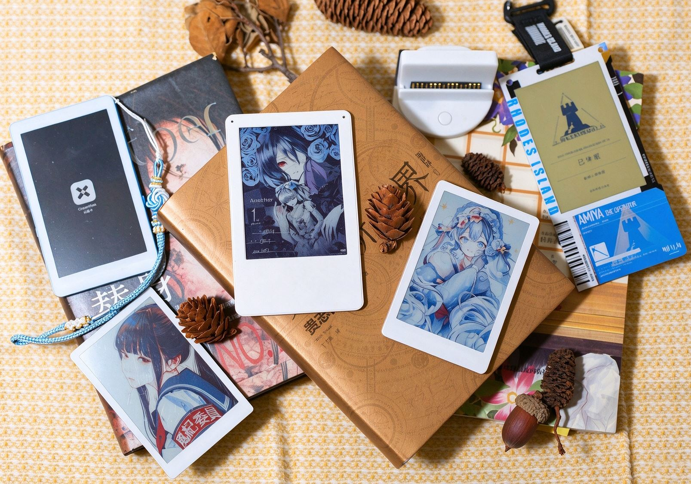
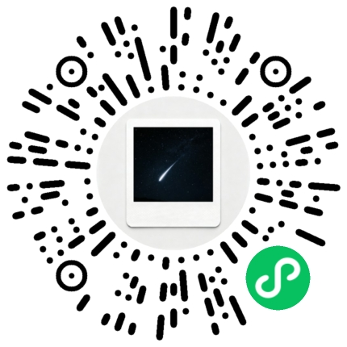

# 帧影（FrameFilm）

[中文](README.md) ｜ [English](README.en.md)

<div align="center">



*彩色电子纸显示 × 低功耗 × 多端传输*

[](LICENSE)
[](https://www.espressif.com/) 

</div>

---

## 项目概述

帧影（FrameFilm）是一套彩色电子纸系列产品及其配套工具。

硬件包括冰箱贴（基础版 / Pro）、桌面电子相册 Max、通行证版 Ark 和墨水屏底座 Dock。各产品均使用彩色电子纸屏幕，可断电保留画面，支持蓝牙、WiFi 或 USB 连接，接收来自手机、网页或云端服务的图片并显示。

"帧影"取"一帧一影，定格时光"之意，英文名 FrameFilm 由"帧"（frame）与"胶片"（film）组成。

配套软件包括设备端 app（图片 / 模板 / 时钟 / 动图 / 通行证）、Web 工具 ForFilm、微信小程序、Flutter 手机 App，以及局域网部署的 Film-hub 云服务。

## 产品线

| 产品 | 固件目录 | 屏幕 | 特点 |
|------|---------|------|------|
| 冰箱贴 基础版 | `firmware/frame_film`（`FRAMEFILM_STD`） | 3.6" 600×400 | 旋转编码器（带按键）、WS2812 灯 |
| 冰箱贴 Pro 版 | `firmware/frame_film`（`FRAMEFILM_PRO`） | 3.68" 792×528 | 三按键、WiFi、无线充电 |
| 电子相册 Max 版 | `firmware/frame_film`（`FRAMEFILM_MAX`） | 7.09" 1200×1600 双面板 | 大屏电子相册、三按键、无 LED |
| 通行证版 Ark | `firmware/frame_film_ark` | 3.70" 720×480 | 单机型；含 app 框架与 LVGL UI 层 |
| 墨水屏底座 Dock | `firmware/frame_film_dock` | 3.64" 760×568 | USB 复合设备：声卡 + HID 键盘 + CDC 串口 |
| 小萤 FilmReader | 衍生整机（FrameFilm 主板 + CrossMux 固件） | 3.97" 800×480 四灰阶 | 黑白墨水屏阅读器；四键、SD 卡、无线充电 |

> 基础版 / Pro / 电子相册 Max 三机型共用同一套固件，靠机型宏 + `sdkconfig` 编译隔离；屏幕可在 `hal_epd.h` 中按机型自由选择（见下方「可选屏幕」）。

## 硬件开源工程

各产品的原理图、PCB、BOM、外壳与生产文件均在立创开源平台：

| 工程 | 说明 |
|------|------|
| [FrameFilm 标准版](https://oshwhub.com/kiritro/project_ttfkoxxv) | 冰箱贴基础版，E6 全彩 V2 |
| [FrameFilm 星火版](https://oshwhub.com/kiritro/project_uaqmgawa) | 电路优化版：NU1680 无线充电、32pin 3.7" E6 与 24pin 1.54" E6 兼容，提供三个硬件版本 |
| [FrameFilm Dock](https://oshwhub.com/kiritro/project_pgrmtgch) | 墨水屏底座（声卡 / HID / CDC） |
| [小萤 FilmReader](https://oshwhub.com/kiritro/project_bppplpbn) | 3.97" 黑白墨水屏阅读器衍生整机 |

**衍生模块：**

| 模块 | 说明 |
|------|------|
| [E-Ink 彩色 E6 墨水屏驱动模块](https://oshwhub.com/kiritro/project_wlvjnmls) | 适配 3.6 / 4 / 7.3 寸微雪、佳显 E6 彩色墨水屏 |
| [NU1680 无线充电接收模块](https://oshwhub.com/kiritro/project_tscyabux) | 5V / 1A，支持 Qi，15×10×0.8 mm，可选防倒灌，MIT 许可 |

> 主板设计与固件以本仓库为准；立创工程用于打样与复刻，BOM、装配与打样参数以各自工程附件为准。

## 核心功能

- **彩色电子纸显示**：断电保留画面，无背光、低功耗。
- **图像转换**：多种抖动算法，将照片转换为六色画面，支持单图、多帧与动画。
- **多种连接方式**：手机 / 网页走蓝牙；Pro 与 Ark 支持 WiFi；底座可用 USB。
- **安装方式**：冰箱贴为背部磁吸，电子相册 Max 桌面摆放。
- **设备端 UI 与内容 app**（仅通行证版 Ark）：图片、模板、时钟、动图、通行证五个内容 app，含主菜单、系统设置、开机画面与休眠卡；支持 BLE 按键遥控（`0x4E`）与时间同步（`0x4D`）。
- **底座即电脑外设**（仅 Dock）：按键可作为 PC 键盘，USB 同时枚举出声卡与虚拟串口，可直接传图。
- **云端下发**：配合 Film-hub 可远程更新画面，或按时间自动轮播。

## 固件组件

三条固件线均按 **`film_service` → `film_hal` → `film_sys`** 单向分层，不得逆依赖。

| 组件 | 说明 | `frame_film` | `frame_film_ark` | `frame_film_dock` |
|------|------|:---:|:---:|:---:|
| `film_sys` | 系统初始化、日志、配置、事件总线 | ✅ | ✅ | ✅ |
| `film_service` | BLE 通信、文件管理、照片播放、参数存储 | ✅ | ✅ | ✅ |
| `film_hal` | 电子纸、电池、LED、输入、SD、USB | ✅ | ✅ | ✅ |
| `film_app` | app 框架：调度、菜单、设置、内容 app | — | ✅ | — |
| `film_ui` | LVGL UI 层：页面生命周期、显示链路、资源 | — | ✅ | — |

> Dock 的 BLE 与 USB 共用同一套命令解析（`film_service/src/service_cmd.c`），新增命令只需改这一处。

## 可选屏幕

屏幕不与机型绑定：在 `hal_epd.h` 的对应机型分支内，把目标 `EPD_SELECT_E6_*` 置 `1`、其余置 `0` 即可切换。

| 屏幕 | 分辨率 | 面板 ID | 宏 | 驱动 |
|------|--------|---------|-----|------|
| 3.68" | 792×528 | 0x01 | `EPD_SELECT_E6_3_68_792_528` | `hal_epd_368.c` |
| 3.70" | 720×480 | 0x02 | `EPD_SELECT_E6_3_70_720_480` | `hal_epd_370.c` |
| 3.6" | 600×400 | 0x03 | `EPD_SELECT_E6_3_60_600_400` | `hal_epd_360.c` |
| 1.54" | 240×240 | 0x04 | `EPD_SELECT_E6_1_54_240_240` | — |
| 7.09" 双面板 | 1200×1600 | 0x05 | `EPD_SELECT_E6_7_09_1600_1200` | `hal_epd_709.c` |
| 3.64" | 760×568 | 0x06 | `EPD_SELECT_E6_3_64_760_568` | `hal_epd_364.c`（Dock 默认） |
| 3.98" | 768×552 | 0x07 | `EPD_SELECT_E6_3_98_768_552` | `hal_epd_398.c` |
| 3.98" 四色 | 768×552 | 0x08 | `EPD_SELECT_E4_3_98_768_552` | `hal_epd_398e4.c` |
| 3.97" 黑白 | 800×480 | — | — | FilmReader 采用 SSD1677（四灰阶），本仓库无驱动 |

> `0x07`（SE0398 3.98"）为新增可选屏，默认关闭，需手动置 `1` 启用；它走 4 线 SPI + DC，仅适用于 STD / Pro 的接线（Max 无 DC 脚）。
> `0x08`（JD79665AA 3.98" 四色）只有黑/白/黄/红，ForFilm 检测到该面板后自动按四色出图；全刷约 15 s，同样只适用于 STD / Pro 接线。
> 3.97" 黑白屏（SSD1677）用于衍生整机「小萤 FilmReader」，运行 CrossMux 固件，本仓库三套固件均未包含其驱动，详见下方「小萤 FilmReader」。
> 面板 ID 随 `0x42` 回包给连接端，客户端据此校正分辨率；客户端机型仍以 BLE 广播名为准。

## 硬件规格

### FrameFilm（基础版）

| 参数 | 规格 |
|------|------|
| 主控芯片 | ESP32-S3 WROOM N16R8 |
| 显示屏 | 彩色电子纸 3.6" 600×400 (WFT驱动) |
| 存储 | TF卡 最大32GB 或 内置SDnand |
| 通信 | 蓝牙 BLE 4.2 |
| 交互 | 旋转编码器（带按键） |
| 电池 | 锂电池 304040规格 1.5mm插头 |
| 尺寸 | 约 92 × 60 × 7 mm |
| 安装方式 | 背部磁吸 磁铁 2x12mm-1mm 1x15mm-2mm |

### FrameFilm Pro

| 参数 | 规格 |
|------|------|
| 主控芯片 | ESP32-S3 mini N4R2 |
| 显示屏 | 彩色电子纸 3.68" 792×528 (SE0368-C驱动) |
| 存储 | 内置SDnand |
| 通信 | 蓝牙 BLE 4.2 / WiFi |
| 交互 | 三按键 |
| 电池 | 锂电池 244147规格 |
| 充电 | 支持无线充电（兼容 MagSafe 充电器） |
| 尺寸 | 约 90 × 59 × 5 mm |
| 安装方式 | 背部磁吸 magasafe磁环 |

### FrameFilm Max（电子相册）

| 参数 | 规格 |
|------|------|
| 主控芯片 | ESP32-S3 N16R8（16MB Flash / Octal PSRAM） |
| 显示屏 | 彩色电子纸 7.09" 1200×1600 双面板 |
| 存储 | TF卡 |
| 通信 | 蓝牙 BLE 4.2 |
| 交互 | 三按键 |
| 灯效 | 无 RGB LED |
| 电池 | 无电池电量检测 |

### FrameFilm 通行证（Ark）

| 参数 | 规格 |
|------|------|
| 主控芯片 | ESP32-S3 N4R2（4MB Flash / Quad PSRAM） |
| 显示屏 | 彩色电子纸 3.70" 720×480（面板 ID `0x02`） |
| 存储 | TF卡（带检测脚） |
| 通信 | 蓝牙 BLE 4.2 |
| 交互 | 三按键（上 / 下 / 确认，低有效） |
| 灯效 | WS2812（白=未连接、绿=已连接、红=低电） |
| 电池 | 锂电池，带电量检测 |

### FrameFilm Dock（墨水屏底座）

| 参数 | 规格 |
|------|------|
| 主控芯片 | ESP32-S3 N16R8（16MB Flash / Octal PSRAM） |
| 显示屏 | 彩色电子纸 3.64" 760×568（面板 ID `0x06`） |
| USB | 复合设备：UAC 声卡 + HID 键盘 + CDC 虚拟串口（VID/PID `0x303A`/`0x8000`） |
| 音频 | ES8311 + NS4150B 语音模块（麦克风 + 扬声器） |
| 交互 | 三按键（作为 PC 键盘键值发送） |
| 通信 | 蓝牙 BLE 4.2 + USB |

## 小萤 FilmReader（衍生整机）

小萤 FilmReader 是基于 FrameFilm 主板制作的 **3.97 寸黑白墨水屏阅读器**，属于 FrameFilm 的衍生整机：核心电路沿用 FrameFilm 主板，主要在 PCB 拼接（panel）、外壳、前面板与整机装配上适配。它没有触摸与背光，只有四个按键，价值在于可低成本复刻、改固件与换外壳。

**立创开源工程（原理图 / PCB / BOM / 外壳 / 前面板）：** <https://oshwhub.com/kiritro/project_bppplpbn>

| 参数 | 规格 |
|------|------|
| 主控芯片 | ESP32-S3（16MB Flash / 8MB PSRAM） |
| 显示屏 | 黑白四灰阶 3.97" 800×480（SSD1677） |
| 存储 | SD 卡（4-bit SDMMC） |
| 交互 | 四按键：UP / DOWN / CONFIRM+PWR / BACK |
| 充电 | MagSafe 无线充电 |
| 其他 | 32.768 kHz RTC 晶振、WS2812 状态灯、深度休眠外设断电 |
| 主板配置 | 沿用 FrameFilm 主板；焊点 P1 断开 / P2 断开 / P3 连接 |

- **固件**：使用 [CrossMux](https://github.com/0x1abin/crossmux)，本机适配版见 [kirmisaki/crossmux](https://github.com/kirmisaki/crossmux)
- **刷写**：用 [ForFilm Web 工具](https://kirmisaki.github.io/FrameFilm/tools/ForFilm/) 的「串口烧录」写入立创工程附件中的 `firmware.factory.bin`
- **复刻资料**：外壳 `FilmReader外壳.3mf`、`BOM_Board_FilmReader材料清单.xlsx` 均在立创工程附件中；前面板按亚克力 0.8 mm、要背胶、普通遮光、背面印刷打样
- **复刻交流群**：1103626779

> 主板设计与 FrameFilm 共用，遵循本仓库 GPLv3 许可；阅读器固件与整机资料分别在 CrossMux 仓库与立创工程维护。

## 项目结构

```
FrameFilm/
├── assets/                     # 资源文件
│   └── pic/                   # 产品图片和渲染图
│
├── docs/                      # 文档资料
│   ├── blecmd/                # BLE 通信协议文档
│   ├── datasheet/             # 芯片和模块数据手册
│   ├── film/                  # film 文件格式规范
│   ├── filmhub/               # 云端相框服务设计文档
│   ├── filmagent/             # 语音交互（FilmAgent）设计与音频驱动
│   ├── hardware/              # 硬件规格说明文档
│   ├── knowledge/             # AI 知识库（架构/规范/命令速查）
│   ├── wifi/                  # WiFi 功能说明
│   ├── ci-builds.md           # Ark 自动构建与发布说明
│   └── ARK_CHANGELOG.md       # 通行证版更新日志
│
├── firmware/                   # 设备固件 (ESP-IDF)
│   ├── frame_film/            # 冰箱贴 / 电子相册本体（三机型，可切换屏幕）
│   │   ├── components/
│   │   │   ├── film_service/  # 服务层
│   │   │   ├── film_sys/      # 系统层
│   │   │   └── film_hal/      # 硬件抽象层
│   │   ├── main/              # 主程序
│   │   └── sdkconfig_*        # 各机型配置 (std/pro/max)
│   ├── frame_film_ark/        # 通行证版（单机型；含 app 框架与 UI 层）
│   └── frame_film_dock/       # 墨水屏底座（单机型；BLE + USB）
│
├── app/                        # 手机 App
│   ├── android/                # Ark Android 客户端（Kotlin 通信内核）
│   └── flutter_app/            # Ark Flutter 客户端（当前主线 UI）
│
├── hardware/                   # 硬件设计
│   ├── pcb/                   # PCB 电路原理图
│   └── model/                 # 外壳 3D 模型
│
├── server/                     # 云端服务
│   └── filmhub/               # film-hub（局域网后端 + 管理前端）
│       ├── backend/           # 后端 API 服务 (FastAPI)
│       └── web/               # Web 管理前端
│
├── tools/                      # 开发工具
│   ├── ForFilm/               # Web 端相框管理工具（BLE / USB / 串口）
│   ├── wechart/               # 微信小程序
│   ├── framefilm-dock-upload/ # 底座 USB 传图工具
│   ├── convert/               # 照片转换工具
│   ├── ui-mockup/             # 设备端 UI 视觉设计稿
│   ├── ui-assets/             # UI 图标 / 开机图资源生成
│   ├── ui-fonts/              # UI 字库生成
│   ├── clock-font/            # 时钟大字号字库生成
│   ├── ark-font/              # 通行证字库生成
│   ├── ark-pass-editor/       # 通行证档案编辑工具
│   ├── ark-ui-simulator/      # Ark UI 模拟器
│   └── film_viewer/           # film 文件查看器
│
├── AGENTS.md                   # AI 开发指南
├── README.md                   # 项目说明文档（中文）
├── README.en.md                # 英文说明文档
└── LICENSE                     # 许可证
```

## 快速开始

### 固件开发

固件分三个工程，**只有 `frame_film` 需要先做机型配置**（替换 sdkconfig + 修改机型宏 + 选屏）；`frame_film_ark`（通行证版，单机型，支持 4MB/Quad 与 16MB/Octal 两种存储变体）默认直接编译，切换方式见下文；`frame_film_dock`（底座，单机型）直接编译烧录。

> app 框架与 UI 层（LVGL UI 层 + app 层）**仅 `frame_film_ark` 有**；`frame_film` 是经典固件（无 app 层 / UI 层）。

以下为 **`frame_film`（三机型）** 的配置步骤：

1. **环境要求**
   - ESP-IDF v5.5.4（与仓库 CI 保持一致）

2. **配置目标机型与屏幕**
   - 替换 `sdkconfig`：将 `firmware/frame_film/sdkconfig_<机型>` 复制为 `sdkconfig`
   - 修改设备类型宏：编辑 `firmware/frame_film/components/film_sys/inc/sys_cfg.h`，将对应机型宏置 1（三选一）
   - 选择屏幕：编辑 `firmware/frame_film/components/film_hal/inc/hal_epd.h`，在对应机型分支内将目标屏幕的 `EPD_SELECT_E6_*` 置 1、其余置 0

   | 机型 | 替换用的 sdkconfig | sys_cfg.h 宏 | 默认屏幕 |
   |------|--------------------|--------------|---------|
   | 基础版 | `sdkconfig_std` | `FRAMEFILM_STD` | 3.6" 600×400 |
   | Pro 版 | `sdkconfig_pro` | `FRAMEFILM_PRO` | 3.68" 792×528 |
   | Max 版（电子相册） | `sdkconfig_max` | `FRAMEFILM_MAX` | 7.09" 1200×1600 双面板 |

   可选屏幕与对应宏见上方「可选屏幕」表。

   ```bash
   cd firmware/frame_film
   cp sdkconfig_std sdkconfig   # 示例：基础版；Pro/Max 版同理
   ```

3. **编译固件**
   ```bash
   idf.py build
   ```

4. **烧录固件**
   ```bash
   idf.py flash monitor
   ```

#### 用 ForFilm 网页烧录固件（无需 ESP-IDF 环境）

ForFilm 的「设置 → 串口烧录 · 完整固件」通过浏览器的 Web Serial 直接写 Flash，等价于 `idf.py flash`。相比蓝牙 OTA 更快，且能刷 bootloader 与分区表（OTA 只能写应用分区）。

1. 打开 [ForFilm Web 工具](https://kirmisaki.github.io/FrameFilm/tools/ForFilm/)。本地使用方式见 [tools/ForFilm/README.md](tools/ForFilm/README.md)（需以 `tools` 为根启动静态服务）。
2. 使用桌面版 Chrome / Edge（支持 Web Serial；Safari、Firefox 不支持），USB 线连接设备。
3. 进入「设置 → 串口烧录」，点「检测串口」选择设备对应的 COM 口。
4. 点「选择固件文件」：
   - 分文件烧录：一次全选 `build/` 下的 `bootloader.bin`、`partition-table.bin`、`ota_data_initial.bin`、`frame_film.bin`，偏移按文件名自动匹配（0x0 / 0x8000 / 0x29000 / 0x30000）。
   - 整片烧录：只选一个由 `idf.py merge-bin` 生成的合并镜像，页面会按文件内容识别并从 0x0 写入。
5. 波特率保持默认 460800（可选「先整片擦除」），点「开始烧录」。
6. 烧录完成后设备自动复位，需要重新连接蓝牙。

> 烧录前先关闭 `idf.py monitor` 等占用串口的程序。只选应用镜像时不要勾选「合并镜像」，否则会从 0x0 写入并覆盖 bootloader。
> `frame_film_ark` 与 `frame_film_dock` 的 `build/` 产物同样可以用这个入口烧录。

**通行证版 / 底座：**

```bash
cd firmware/frame_film_ark   # 通行证版 FRAMEFILMARK（3.70" 720×480，三按键）
idf.py build flash monitor               # 默认 n4r2：4MB Flash / Quad PSRAM
.\build.ps1 n16r8 flash COM15            # n16r8：16MB Flash / Octal PSRAM（PowerShell）

cd firmware/frame_film_dock  # 墨水屏底座 FRAMEFILMDOCK（3.64" 760×568）
idf.py build flash monitor
```

> `frame_film_ark` 有 `sdkconfig`（n4r2）与 `sdkconfig_n16r8` 两份，用 `build.ps1` 或 VS Code 的 `ESP-IDF: 选择项目配置` 切换；`frame_film_dock` 只有一份 `sdkconfig`。两者都不需要改机型 / 屏幕宏。

#### 使用 VS Code ESP-IDF 插件

项目已包含 `.vscode/settings.json`（IDF 路径已配置），按以下步骤即可编译烧录：

1. 安装扩展：VS Code 扩展商店搜索 **Espressif IDF** 并安装
2. 打开项目：文件 → 打开文件夹 → 选择 `firmware/frame_film`（通行证版选 `firmware/frame_film_ark`，底座选 `firmware/frame_film_dock`）
3. 配置机型：与命令行方式相同（替换 `sdkconfig` + 修改 `sys_cfg.h` 机型宏）—— **仅 `frame_film` 需要；`frame_film_ark` / `frame_film_dock` 跳过此步**
4. 选择目标芯片：底部状态栏点击芯片图标，选择 **esp32s3**
5. 通行证版选硬件变体：命令面板 → **`ESP-IDF: 选择项目配置`** → `n4r2`（4MB/Quad，默认）或 `n16r8`（16MB/Octal）；构建目录分别为 `build_n4r2` / `build_n16r8`
6. 选择串口：底部状态栏点击 **COM 端口**，选择设备对应的串口
7. 编译：点击底部状态栏的 **构建图标（火焰）**，或按 `Ctrl+E` 然后 `B`
8. 烧录：点击 **烧录图标**，或按 `Ctrl+E` 然后 `F`
9. 串口监视：点击 **监视图标**，或按 `Ctrl+E` 然后 `M`（`Ctrl+]` 退出）

> 提示：首次构建时间较长属正常；若更换串口/芯片，在底部状态栏重新选择即可。

### 手机 App（通行证版）

Ark 的手机端当前主线是 **Flutter** 工程（`app/flutter_app/`），复用 `app/android/` 里的 Kotlin BLE / WiFi Direct 通信内核，不使用 WebView：

- 六页：连接、Frame、Film、动画、通行证、设置
- 两套视觉：ForFilm 暖色圆角、明日方舟 PRTS 炭灰黑白冷蓝
- 连接后 BLE 负责控制与状态，图片 / 动画 / 通行证 / OTA 走临时 WiFi Direct 直传

构建、验证范围与签名配置见 [app/flutter_app/README.md](app/flutter_app/README.md) 与 [docs/ci-builds.md](docs/ci-builds.md)。

### 底座 USB 传图

底座插到电脑后会枚举出虚拟串口，可直接用现成脚本传图：

```bash
# 上传一张图片（自动找串口 → 握手 → 转换 → 上传 → 回读校验）
python tools/framefilm-dock-upload/scripts/dock_upload.py photo.jpg

# 列出 / 校验设备上已有的 film 文件
python tools/framefilm-dock-upload/scripts/dock_upload.py --list
```

完整参数与排查表见 [tools/framefilm-dock-upload/SKILL.md](tools/framefilm-dock-upload/SKILL.md)。

### 照片转换

#### ForFilm
ForFilm Web 工具，支持以下功能：

- **照片格式转换** - 将普通照片转换为 .Film 格式文件
- **蓝牙连接** - 与 FrameFilm 设备通过蓝牙连接实现控制和文件传输管理
- **USB 连接** - 连接底座（Dock）的虚拟串口进行配置与传图
- **串口烧录** - 通过浏览器直接烧录固件（esptool）
- **OTA升级** - 无线更新设备固件
- **抖动效果调整** - 实时调整照片转换参数和抖动效果
- **高级色彩** - Ark 支持 46 / 55 色索引色输出，Pro / Ark 支持 SZ 增强

**在线工具（GitHub Pages）：**
👉 [FrameFilm Web 工具](https://kirmisaki.github.io/FrameFilm/tools/ForFilm/)

#### 微信小程序

FrameFilm 微信小程序，方便在手机端管理和传输照片：

- **蓝牙连接** - 连接 FrameFilm 设备进行通信
- **相框管理** - 管理多个相框设备
- **照片传输** - 从手机相册上传或直接拍照发送到设备
- **手绘创作** - 在手机上手绘图案并发送显示

**小程序码，扫码即可体验。**  


#### Film-hub（云端相框服务）

局域网部署的云端相框服务，为设备提供 WiFi 内容推送、模板渲染与远程管理能力：

- **设备管理** - 设备心跳注册与认领，实时查看电量、在线状态与设备配置
- **相册管理** - 批量上传照片，服务端转换生成 film 文件
- **模板引擎** - 内置日历/天气/备忘录/倒计时等模板，支持画布拖拽自定义
- **轮播流** - 编排多模板轮播（相对/绝对时间调度），设备定时拉取更新
- **AI 接入** - 对话生成模板、AI 生图

**技术栈：** FastAPI + SQLite + Vue 3，单机局域网部署。

- 设计文档：[docs/filmhub/](docs/filmhub/)（需求与技术方案）
- 后端源码：`server/filmhub/backend/` ｜ Web 前端：`server/filmhub/web/`

#### FilmAgent（研究/设计中）

面向底座的语音交互方向：语音对话驱动墨水屏生成画面，并复用 Film-hub 后端。当前处于设计与音频驱动阶段，见 [docs/filmagent/](docs/filmagent/)。

## 开发指南

详细的开发文档请参考各模块 README：

- [固件开发](firmware/README.md) - ESP32 固件代码开发
- [AI 开发指南](AGENTS.md) - 分层约束、机型/屏幕矩阵、BLE 命令速查、常见陷阱
- [Flutter 手机 App](app/flutter_app/README.md) - 页面、双主题与 WiFi Direct 直传
- [Ark Android 通信内核](app/android/README.md) - Kotlin BLE / P2P 实现
- [硬件设计](hardware/README.md) - PCB 和外壳设计文件
- [工具使用](tools/README.md) - ForFilm Web 工具和辅助脚本
- [微信小程序](tools/wechart/README.md) - 小程序源码
- [Ark 自动构建](docs/ci-builds.md) - CI 产物与签名说明
- [Film-hub 云端服务](docs/filmhub/) - 相框云服务需求与技术方案

技术文档目录：

- [docs/blecmd/](docs/blecmd/) - BLE 通信协议文档
- [docs/datasheet/](docs/datasheet/) - 芯片和模块数据手册
- [docs/film/](docs/film/) - Film 文件格式规范
- [docs/filmhub/](docs/filmhub/) - 云端相框服务需求与技术方案
- [docs/filmagent/](docs/filmagent/) - 语音交互设计与音频驱动
- [docs/hardware/](docs/hardware/) - 硬件规格说明
- [docs/knowledge/](docs/knowledge/) - AI 知识库（架构/规范/命令速查）
- [docs/wifi/](docs/wifi/) - WiFi 功能说明

## 免责声明

本项目（FrameFilm/帧影）为开源学习与兴趣制作项目，所提供的一切源码、硬件设计、文档及资料均按「现状」提供，仅供学习、研究与非商业用途参考。

- 本项目不提供任何明示或暗示的保证，包括但不限于对适销性、特定用途适用性及不侵权的保证。
- 使用者应自行评估并承担因使用本项目资料（包括固件烧录、电路制作、电池连接、磁吸安装、无线充电等）所产生的一切风险与后果；因操作不当、硬件差异或元件批次差异导致的设备损坏、数据丢失、人身伤害或财产损失，项目作者与贡献者不承担任何责任。
- 本项目涉及蓝牙、WiFi、云端服务等功能，使用者须遵守所在国家/地区的法律法规及无线电管理规定，不得用于任何违法用途。
- 使用者基于本项目代码或资料所实施的任何行为（包括但不限于复制、修改、分发、商业使用或二次开发）若引发侵犯第三方权利（如知识产权、商标、专利、肖像、隐私等）或其他纠纷，均由实施该行为的使用者自行承担全部责任，本项目作者与贡献者概不负责。
- 项目中的产品图片、渲染图及品牌名称仅供参考，不构成任何商业承诺或质量保证。

使用本项目即视为已阅读并同意上述条款。

## 开源许可

本项目基于 [GNU General Public License v3.0 (GPLv3)](LICENSE) 开源。

## 致谢

- [ESP-IDF](https://github.com/espressif/esp-idf) - ESP32 开发框架
- [LVGL](https://lvgl.io/) - 设备端 UI 图形库
- [Flutter](https://flutter.dev/) - 移动端 App 框架
